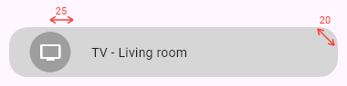
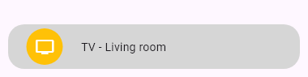
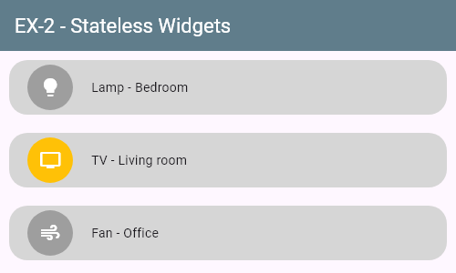

# W7 - Practice Test (G4)

In this exercise, build a stateless `DeviceCard` widget.

## Device card

A `DeviceCard` is composed of a circular avatar showing the device's icon, and text showing the device's name and room, separated by ` - ` (e.g. `TV - Living room`). The example below shows the dimensions and spacing of a device that is off:



A device can also be on. When it is on, the avatar background is **amber** (`Colors.amber`); when it is off, the avatar background is **grey** (`Colors.grey`). The icon is white in both cases:



## Devices

A device is defined with an enum because there are only six different devices. Each device has a name, an icon, and the room where it is installed:

```dart
enum Device {
  lamp(name: "Lamp", icon: Icons.lightbulb, room: "Bedroom"),
  tv(name: "TV", icon: Icons.tv, room: "Living room"),
  fan(name: "Fan", icon: Icons.air, room: "Office"),
  speaker(name: "Speaker", icon: Icons.speaker, room: "Kitchen"),
  heater(name: "Heater", icon: Icons.local_fire_department, room: "Bathroom"),
  camera(name: "Camera", icon: Icons.videocam, room: "Garage");

  const Device({required this.name, required this.icon, required this.room});

  final String name;
  final IconData icon;
  final String room;
}
```

The icons are Flutter's built-in Material icons (`Icons.…`): no image files are needed.

## `DeviceCard` parameters

| Parameter | Type | Required |
|---|---|---|
| `device` | `Device` | Yes |
| `isOn` | `bool` | No; defaults to `false` |

## Main screen

The main screen shall display a list of `DeviceCard` widgets for different devices and on/off states. The mockup below shows an example:



## Displaying icons in a circle

Use `CircleAvatar` with an `Icon` to display a device icon in Flutter:

```dart
CircleAvatar(
  radius: 25,
  backgroundColor: Colors.grey,
  child: Icon(Device.lamp.icon, color: Colors.white),
)
```
