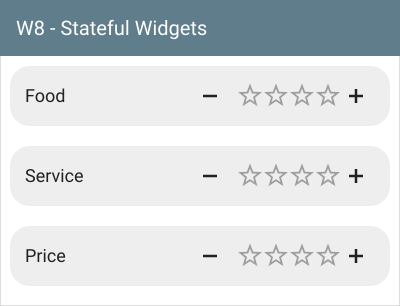
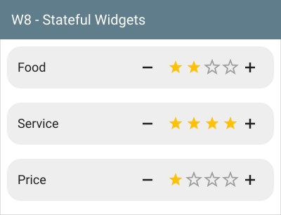

# W8 - Test (G4) – Stateful Widget `StarRating`

**Duration: 40 minutes**

## Your task

The starter code (`lib/main.dart`) contains a `StarRating` widget written as a **`StatelessWidget`**. It already displays the complete UI, but nothing happens when the buttons are pressed.

Convert `StarRating` into a **`StatefulWidget`** and implement the behaviour described below.

## Star rating

A `StarRating` shows a title, a **–** button, 4 stars, and a **+** button:

```
 _____________________________________________
|                                             |
|   Food            –   ★  ★  ☆  ☆   +        |
|_____________________________________________|
```

The number of selected stars is the rating. The selected stars are always **the ones on the left**: with a rating of 2, the 2 stars on the left are selected (filled, yellow), and the other 2 are not selected (outlined, grey).

When the app starts, every rating is 0 (no star selected):



Example after a few clicks (`Food` = 2, `Service` = 4, `Price` = 1):



## Parameter

| Parameter | Type | Required |
|---|---|---|
| `title` | `String` | Yes |

The number of stars is given by the constant `maxStars = 4` (provided in the starter code).

## State

| State | Type | Initial value |
|---|---|---|
| `stars` | `int` | `0` |

## Behaviour

1. Pressing **+** increases the rating by 1.
2. Pressing **–** decreases the rating by 1.
3. The rating can **never go above `maxStars` (4)** and can **never go below `0`**.
4. The first `stars` stars (from the left) are selected; the others are not selected.
5. Star style:

| Star | Icon | Color |
|---|---|---|
| selected | `Icons.star` | yellow (`Colors.amber`) |
| not selected | `Icons.star_border` | grey |

## Main screen

The main screen is already provided: it shows three ratings (`Food`, `Service`, `Price`). Keep it. Each rating must keep **its own** number of stars.

## Useful reminders

```dart
Icon(Icons.star, color: Colors.amber)        // selected star
Icon(Icons.star_border, color: Colors.grey)  // not selected star
```
