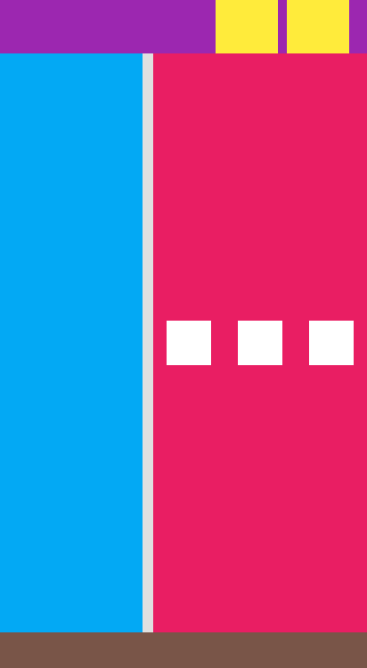
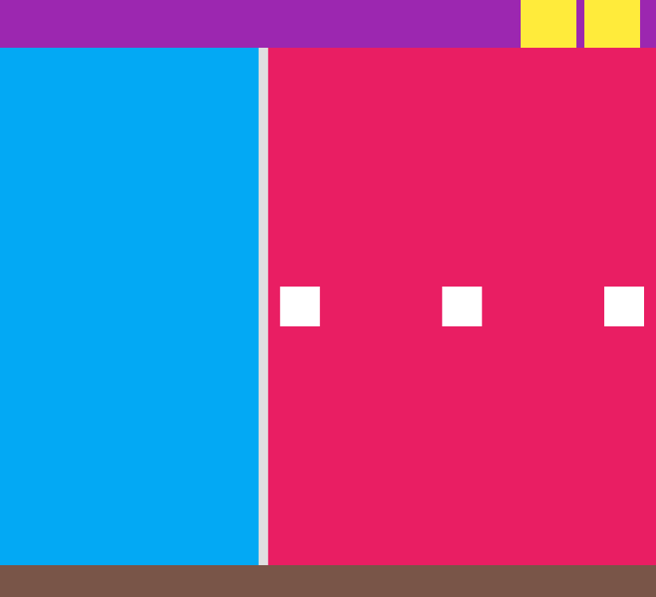

# Flutter Exam – Layout Exercise

## Goal
Build the layout below with Flutter widgets.
Write your code only where you see `// YOUR CODE` in the start code.

## Situation
You are building the skeleton of an **online shop**: a header with two buttons on the right, a list of categories, the products, and a footer.
All the elements are simple colored boxes: no text, no icons.

## Layout

```
                                 |<-70->|10|<-70->|<-20->|
+--------------------------------+------+--+------+------+  ^
|             PURPLE             |YELLOW|  |YELLOW|      |  | 60
+---------------------+--+-------+------+--+------+------+  v
|                     |  |                               |  ^
|                     |  |                               |  |
|                     |  |                               |  |
|      LIGHT BLUE     |  |        PINK (3/5 width)       |  |
|     (2/5 width)     |  |                               |  |
|                     |  |                               |  |
|                     |  |  +-----+   +-----+   +-----+  |  |
|                     |  |  |WHITE|50 |WHITE|   |WHITE|  |  | remaining
|                     |  |  +-----+   +-----+   +-----+  |  | height
|                     |  |    50                         |  |
|                     |  |        15 on each side        |  |
|                     |  |                               |  |
|                     |  |                               |  |
|                     |  |                               |  |
|                     |  |                               |  v
+---------------------+--+-------------------------------+  ^
|                         BROWN                          |  | 40
+--------------------------------------------------------+  v
                      <--> 12 (grey gap)
```

Note: there is **no** gap between the header, the main area and the footer.

## Expected rendering



Example on a 412 x 750 screen.



Same view on a wider screen (824 x 750). The fixed sizes stay the same on any screen; the flexible areas adapt.

## Rules
- The root widget of `body` must be a `Column` (already in the start code)
- Do **not** use fixed widths for light blue and pink: the layout must adapt to any screen size
- Do not change the code outside `// YOUR CODE`

## Start code

```dart
import 'package:flutter/material.dart';

void main() {
  runApp(
    MaterialApp(
      debugShowCheckedModeBanner: false,
      home: Scaffold(
        backgroundColor: Colors.grey[300],
        body:
            // YOUR CODE
            Column(),
      ),
    ),
  );
}
```
